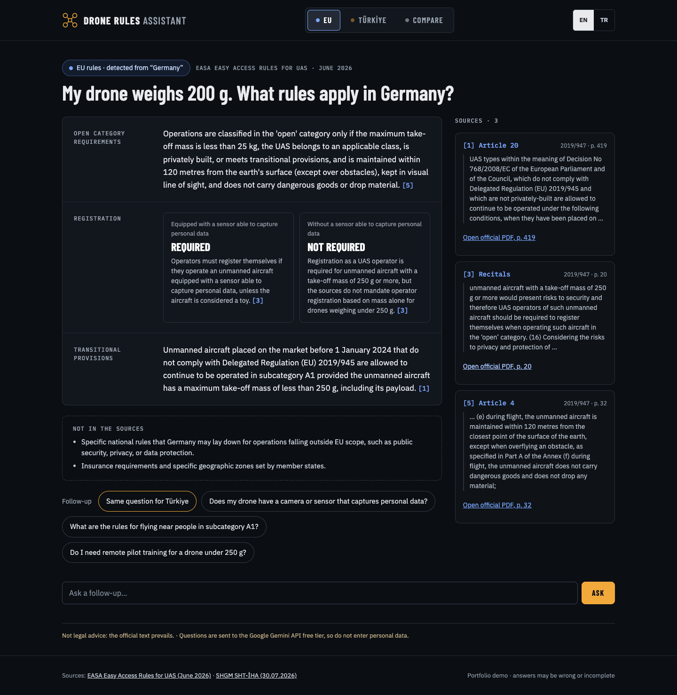
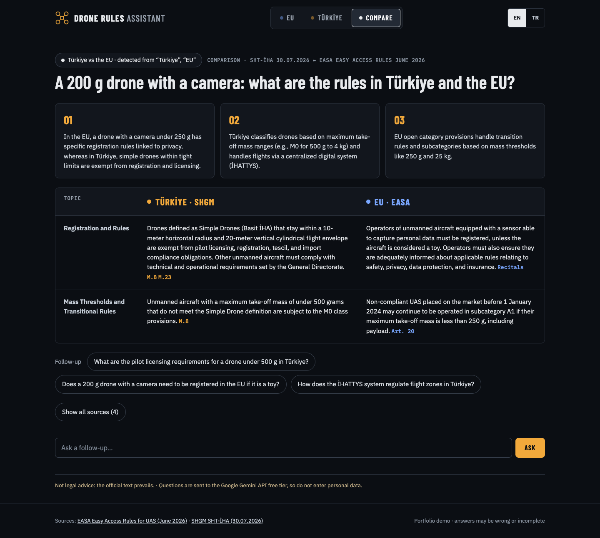
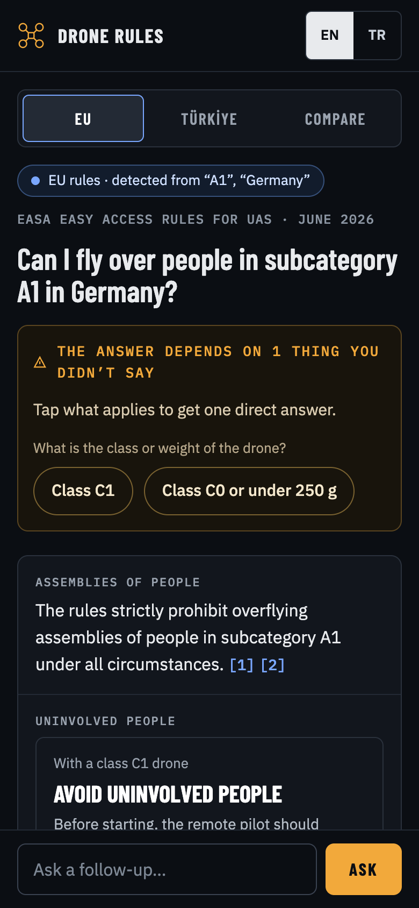

# drone-regs-assistant

A small retrieval-augmented generation (RAG) demo that answers questions about drone rules in
the European Union (EASA Easy Access Rules for Unmanned Aircraft Systems) and Türkiye (SHGM
SHT-İHA), citing the article and page each statement comes from. It works in English and
Turkish, can compare the two sides, and says when the answer depends on something the question
leaves out. It is a portfolio project, not a product, and its answers are not legal advice: the
official texts always prevail.

**Live demo:** https://drone-regs-assistant.onrender.com. The first load after the site has
been idle can take up to a minute (free hosting; about 30 seconds when measured).

| Answer | Comparison | Phone |
|---|---|---|
|  |  |  |

## How it works

- **Jurisdiction:** the question's own words decide whether it is about the EU, Türkiye or
  both (countries, cities, authorities, licence and class names); no extra model call. The
  page's switch can always override it.
- **Retrieval:** one embedding of the question, then hybrid search in Postgres: vector
  similarity, full text and any article the question names, fused by rank.
- **Answer:** one Gemini call returns a structured answer: sections, cases for conditions the
  question leaves open, what the answer depends on, what the sources do not say, and a
  comparison table.
- **Checks:** the server drops any part without a valid citation and keeps each side of a
  comparison to its own sources. Every source links to its page in the official PDF.
- **Page:** plain HTML, CSS and JavaScript; model output is set as text only, under a strict
  Content Security Policy; fonts are served from the site itself.

Diagrams and details: [docs/ARCHITECTURE.md](docs/ARCHITECTURE.md). Deployment (Render and
Neon, free tiers): [docs/DEPLOY.md](docs/DEPLOY.md).

## Sources and versions

| Jurisdiction | Text | Version |
|---|---|---|
| EU | [EASA Easy Access Rules for Unmanned Aircraft Systems](https://www.easa.europa.eu/en/document-library/easy-access-rules/easy-access-rules-unmanned-aircraft-systems-regulations-eu) (Regulations (EU) 2019/947 and 2019/945, with AMC and GM) | Revision from June 2026 |
| Türkiye | [SHGM SHT-İHA](https://web.shgm.gov.tr/documents/sivilhavacilik/files/mevzuat/sektorel/talimatlar/SHT-IHA(1).pdf) (İnsansız Hava Aracı Sistemleri Talimatı) | 30.07.2026 |

The PDF and XML files are not in this repository: they belong to their publishers, and the copy
used here should always be the official one. `python -m ingest.download` fetches them and checks
them against the SHA-256 hashes in `sources.yaml`, so a changed file is noticed, not used
silently.

## Evaluation

41 questions: 36 used for tuning (`eval/questions.yaml`) and 5 held out (`eval/holdout.yaml`),
in Turkish and English, about the EU, Türkiye, both, neither and topics the sources do not
cover. The answer keys were written from the official texts and checked against the official
PDFs. `python -m eval.run` asks each question the way the page does (real Gemini API, run by
hand, never in CI); a second model call per question (the judge) checks the key's facts and must
quote the answer word for word. Every change and its measured effect: `eval/REPORT.md`.

| Tuning set (36 questions) | Baseline | Current |
|---|---|---|
| Jurisdiction detected correctly | 36/36 | 36/36 |
| Expected articles retrieved | 45/56 | 45/56 |
| Required facts in the answer | 45/59 | 48/59 |
| Facts contradicted | 0 | 0 |
| Out-of-scope questions refused | 4/4 | 4/4 |
| Answerable questions refused | 2/32 | 1/32 |

"Current" is measured after prompt changes that were tuned on this same set of questions, so it
flatters the system. The model is not deterministic: two runs of the same configuration differed
by 4 required facts, so small differences are noise.

| Held-out: 5 questions written after tuning, one run | Result |
|---|---|
| Jurisdiction detected correctly | 4/5 |
| Required facts in the answer | 6/11 |
| Facts contradicted | 0 |
| Out-of-scope questions refused | none in this set |
| Answerable questions refused | 1/5 |

Five questions are a small sample (one fact is 9 %), but the drop from 48/59 to 6/11 is the
honest measure. On the held-out set, a misspelled English question about the Turkish P1 licence
was not recognised as Turkish, was searched in the EU text and refused; the other misses were
facts left out of answers built on the right articles. That detection gap was fixed after the
held-out run (P0, P1 and P2 alone now count as a weak Turkish signal; they never appear in the EU
texts). The held-out numbers above are from before the fix, and the held-out run was not
repeated. Details: `eval/HOLDOUT.md`.

A limit of the free tier: the stronger model on the same account (gemini-3.8-flash, 20 requests
a day) could not be compared. On two days, 35 of its 36 requests returned "503 UNAVAILABLE"; the
one answer it gave is no evidence either way.

Retrieval has an option to add a few core articles of each jurisdiction to the passages
(registration, class, licence, zones and technical requirements in SHT-İHA; Articles 4, 9, 14 and
UAS.OPEN.020 in 2019/947), chosen from the structure of the regulations rather than from the
questions. It is off: it raised retrieval (45 to 50 of 56 expected articles) but did not raise
the facts in the answers (measured with an earlier answer key), and made prompts a third longer.

## Limits and privacy

- **Not legal advice.** Answers can be wrong or incomplete; the official text prevails.
- **Gemini free tier.** Questions are sent to the Google Gemini API on its free tier. Under
  Google's terms for unpaid services, submitted content may be used to improve Google's
  products and may be read by human reviewers, so do not enter personal data.
- **Request limits.** 3 questions a minute and 20 a day per address; 12 a minute and 300 a day
  in total. They are counted in memory by a single worker, so they start again from zero when
  the server restarts (the free host can restart it at any time).
- **Addresses.** The app keeps visitors' IP addresses only in memory, as salted hashes, to count
  the limits. It does not write them to the database or to its logs (the web server's access log
  is off). The hosting platform (Render, behind Cloudflare) may keep its own records.
- **Stored data.** `request_log` keeps figures only (mode, sizes, timings, token counts,
  errors); no question text and no address.
- **First load.** The free server sleeps after 15 minutes without visitors; waking it takes up
  to a minute.

## Run locally

Python 3.12, Docker (for Postgres with pgvector) and a Gemini API key:

```bash
python3.12 -m venv .venv
.venv/bin/pip install -r requirements.txt -r requirements-dev.txt
docker compose up -d --wait
cp .env.example .env                      # then set GEMINI_API_KEY in .env
.venv/bin/python -m ingest.download       # official files into data/raw, hash-checked
.venv/bin/python -m ingest.build          # passages into data/chunks
.venv/bin/python -m app.migrate
.venv/bin/python -m ingest.embed          # 746 passages: about 3/4 of a day's free embedding quota
.venv/bin/uvicorn --factory app.main:create_app
```

Then open http://127.0.0.1:8000. With the passages already in the local database,
`python -m scripts.dev_fake_server` serves the page with fake answers and no Gemini key. Tests:
`.venv/bin/pytest` (needs the database) and `node --test frontend/tests/*.test.mjs`.

## How this was built

I flew UAVs professionally before this, so drone rules were a domain I could check myself. Claude Code wrote the code in small pull requests, and a separate Claude session wrote the instructions for each step and reviewed every pull request. I made the decisions (the sources, free-tier hosting, detecting the jurisdiction from the question, the answer structure, the limits), tried it live, asked for changes and merged every pull request. I checked every evaluation answer key against the official PDFs and corrected the references the AI had got wrong. Ask me about the design decisions and the trade-offs behind them.

## License

All rights reserved: the code is published for viewing and evaluation only. See
[LICENSE](LICENSE).
