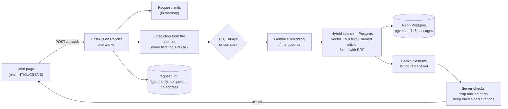
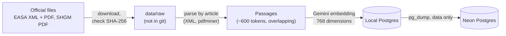

# Architecture

## Answering a question

1. **Mode.** The user's choice wins. Otherwise the server detects the jurisdiction from the
   words of the question (`app/jurisdiction.py`); otherwise it uses the page's current side.
2. **Retrieval.** One embedding request per question. Postgres ranks the passages three ways
   (vector similarity, full text in Turkish or English, and sections the question names, such
   as "UAS.OPEN.020" or "Madde 12") and fuses the ranks (`app/search.py`). A comparison searches
   each source separately, so both sides get passages.
3. **Generation.** One request to gemini-3.5-flash-lite with a JSON schema (`app/schema.py`):
   sections, cases for conditions the question leaves open, what the answer depends on, what is
   not in the sources, and a comparison table. The prompt is in `app/answer.py`.
4. **Checks.** Citations to passages that were not given are dropped; a part left without a
   citation is removed; a comparison cell may cite only its own side. If nothing citable is
   left, the answer is refused.
5. **Page.** Everything from the server is put into the page as text, never as HTML, under a
   strict Content Security Policy.

## Preparing the data (once, offline)

The texts are split along their own structure (articles, rules, AMC and GM) before any split by
size, so every citation points to one article. Page numbers come from the PDF bookmarks of the
same revision. The data was copied to Neon rather than embedded again (see `docs/DEPLOY.md`).

## Evaluation

`eval/run.py` sends each question of `eval/questions.yaml` through the same function the API
uses, and a second model call judges the answer against the key, quoting the answer word for word
(`eval/judge.py`, `eval/score.py`). Results are in `eval/results/` and summarised in
`eval/REPORT.md`; the held-out run is in `eval/HOLDOUT.md`.
